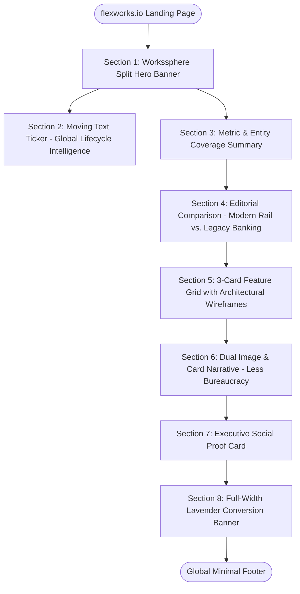

# DESIGN SYSTEM & UI/UX SPECIFICATION: FLEX (`flexworks.io`)

**Brand:** Flex  
**Domain:** `flexworks.io`  
**Industry:** Global Hybrid Payroll, Contractor Management & EOR  
**Partners:** Global EOR Services (Employment & Compliance), Circle (USDC Financial Rails)  
**Visual Foundation:** Workssphere Editorial Theme (Clean Light Canvas, Editorial Serif, Lavender Cards, Architectural Imagery)

---

## 1. Visual Foundation & Design Tokens

### 1.1 Anti-Patterns to Strictly Avoid
* ❌ **No dark-mode digital meters or crypto gas/speedometers** (e.g., neon green speed counters, dark purple terminal boxes, high-contrast digital clocks).
* ❌ **No dark purple/navy-black page backgrounds**.
* ❌ **No glowing terminal boxes, neon status indicators, or cryptocurrency trader styling**.

### 1.2 Approved Workssphere Theme Tokens
* **Page Backdrop**: Clean Light Canvas (`#FAFAFC` / `#FFFFFF`).
* **Primary Surface Tint**: Soft Lavender-Periwinkle (`#D8DBFD`).
* **Secondary Surface**: Pure White (`#FFFFFF`) with subtle border (`border border-slate-200/80`).
* **Primary Contrast**: Deep Near-Black (`#0D0E11`).
* **Muted Copy**: Slate Charcoal (`#475569` / `#64748B`).
* **Accent Highlight**: Electric Lime (`#D2F801`) — reserved solely for high-contrast pills, status chips, or micro-accents.
* **Typography**:
  * **Headlines (H1, H2, H3)**: Editorial Serif (`Newsreader`, `Playfair Display`, or `Instrument Serif`), regular weight (`font-normal`), tight leading (`leading-[1.1]`), letter-spacing (`tracking-tight`).
  * **Body & UI**: Clean geometric sans-serif (`Inter`, `Plus Jakarta Sans`), weights 400, 500, 600.
* **Shape & Elevation**:
  * **Container Radii**: `rounded-3xl` (`24px` to `32px`).
  * **Buttons & Badges**: Fully rounded pills (`rounded-full`).
  * **Imagery**: Architectural workplace photography with organic, curved masks and rounded frames (`rounded-3xl`).
  * **Graphic Motifs**: Thin-line geometric globes, concentric wire rings, and architectural outline icons (matching Workssphere's middle feature cards).

---

## 2. Navigation Structure (Workssphere Layout)

* **Height**: `h-20` (80px), sticky top, `bg-white/90 backdrop-blur-md border-b border-slate-100`.
* **Left**: Brand lockup: `Flex` in clean geometric sans + micro-tag `flexworks.io`.
* **Center**: Editorial text links with subtle chevron dropdown indicators:
  * Products ▾ (Global EOR, Contractor Pay, Circle USDC Rails, Tax Engine)
  * Solutions ▾ (For Startups, Web3 Teams, Global Enterprises)
  * Jurisdictions (150+ Direct Countries Coverage via Global EOR Services)
  * Resources ▾ (Compliance Guides, Calculator, Documentation)
  * Pricing
* **Right**:
  * Ghost Link: `Sign In`
  * Action Pill CTA: `Schedule Strategy Call →` (`bg-[#0D0E11] text-white rounded-full px-6 py-2.5 font-medium hover:bg-slate-800`).

---

## 3. Section Architecture & Flowchart (Workssphere Framing)

